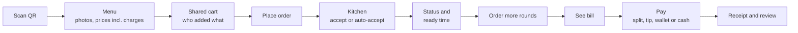

# QR Table Ordering Around the World, and How Bosho Compares

As of 2026-11-22

## Summary

You are right: QR table ordering is not a new idea. China, South Korea, Australia, the UK, the US and much of Europe have used it at scale since about 2018 to 2020, and COVID made it common almost overnight. That is good news for Bosho, not bad news. The idea is proven, and the mistakes are already known, so you can copy what worked and avoid what failed.

The main lessons from abroad:

1. **Paying at the table is the part guests value most.** Abroad, ordering is often second. Sunday (France, UK, US) started with payment only, and me&u's "Pay" product is order-and-pay without the ordering. Bosho is cash-first, which suits Bangladesh today, but online payment is the biggest gap.
2. **Guests turned against QR menus that were forced on them.** In the US and Canada, many restaurants went back to paper menus between 2022 and 2024. Guests complained about small screens, being made to sign up, and data collection. The systems that lasted are the **hybrid** ones: paper menu or waiter still available, QR as an extra.
3. **The winners sit inside the POS.** Toast, Square and Lightspeed bundle QR ordering into the till system the restaurant already uses. Stand-alone apps such as Sunday and me&u have to integrate with those POS systems to survive.
4. **Hidden fees cause trouble.** Sunday is being sued (reported June 2026) over a platform fee shown to guests only at the last step. Show every charge up front.

Bosho already does several things the leaders do: no app to install, no guest signup, a shared table bill, a waiter who can order for guests, prices computed on the server, and names and prices copied onto each order line. The differences are mostly about payment, integration and hardware. They are listed in [section 4](#4-bosho-compared-with-the-leaders).

## 1. How the main markets do it

Each region took a different shape, driven by how people there already pay.

| Region | Typical setup | Who runs it | What is special |
| --- | --- | --- | --- |
| **China** | Scan the table QR, which opens a **WeChat or Alipay mini program**. Order and pay inside it. | Meituan, WeChat Pay, Alipay, and many small SaaS vendors | Payment is built into the super app, so ordering and paying are one step. Alipay publishes design guidelines for restaurant mini programs. Criticised for making guests follow the restaurant's account before ordering, and for collecting data. |
| **South Korea** | A **tablet fixed to every table** (not the guest's phone). Order, call staff, pay. | t'order (more than half the market in 2024), menuit and others | The restaurant owns the device, so no phone or data plan is needed. t'order now earns more and more from **ads shown on the tablets**: over 250,000 tablets, 41.9 billion won revenue in 2025, still loss-making. |
| **Japan** | Mix of table tablets (sushi chains) and QR-on-phone ordering; pay at the counter or self-checkout | POS vendors and chains' own systems | Like Bosho, payment often stays at the counter. Many restaurants keep paper menus alongside. |
| **Australia** | QR **order and pay with an open tab**, mainly pubs and bars | me&u (merged with Mr Yum in 2023), plus POS vendors | Guests open a tab with a card, keep ordering, and close the tab when they leave. Groups can share one tab and get one itemised receipt. |
| **UK and Europe** | QR **pay at table** in restaurants; order and pay in pubs and chains | Sunday, Toast, Lightspeed, Zonal, SumUp | Sunday ties each QR to a table on the POS table map. Guests see the bill, **split it, add a tip** and pay with Apple Pay or Google Pay in seconds. |
| **United States** | QR order and pay built into the POS | Toast, Square, Clover, plus Sunday | Toast: one code per table, guests keep ordering on one tab, split payments, a waiter can open the check and guests join it by scanning. Optional **pre-authorised tab**: guest enters a card before ordering. |
| **Bangladesh (today)** | Mostly **view-only QR menus**; some local POS vendors add QR ordering | HisabPlus, RestroGreen, Restora, Mediasoft, iCafe (food courts), freelance builds | QR ordering is usually a small add-on to a POS whose focus is KOT printing, VAT billing and inventory. Little evidence of a full guest loop (status, shared cart, bill, review) done well. |

## 2. How the leaders handle the hard problems

Every system has to answer the same five questions. Here is how the leaders answer them.

### Fake or prank orders

A printed QR never changes, so someone could order from outside the restaurant.

- **Card first.** Toast and me&u can require a card (pre-authorised tab) before the first order. The order is then paid or guaranteed, so prank orders cost the prankster.
- **Restaurant-owned device.** Korean table tablets avoid the problem entirely, because the device stays on the table.
- **Pay first.** Food courts and fast-casual places take payment before sending the order to the kitchen.

### Groups and shared bills

- Toast and me&u use **one tab per table** that many phones can join, and offer **split bill** at the end: split evenly, pay for your own items, or pay a custom amount.
- Sunday reads the bill from the POS and lets each guest pay their share.

### Kitchen flow

- Orders go straight into the POS and come out on the **kitchen printer (KOT)** or **kitchen display (KDS)** the restaurant already has. Most kitchens abroad do **not** accept orders manually; the order is trusted because it is paid or tied to a card.

### Payment

- Apple Pay and Google Pay make paying take under 10 seconds (Toast's own figure).
- **Card data never touches the restaurant software.** The payment company's hosted page or SDK takes the card, which keeps the restaurant out of most PCI DSS work.
- Tips are suggested as percentages at payment time.

### Waiters

- Every successful system keeps staff. Toast's guidance is that servers greet the table, explain the QR and still deliver the food. me&u publishes training material for front-of-house staff.

## 3. What went wrong abroad (avoid these)

| Mistake | What happened | What Bosho should do |
| --- | --- | --- |
| QR only, no paper menu | Diners in the US and Canada complained; many restaurants brought paper back (2022 to 2024). One restaurant group saw average bills fall 10% because guests did not scroll the whole menu. | Keep waiter ordering (you already do). Suggest restaurants keep a few paper menus. Put best sellers and photos at the top of each category. |
| Forced signup or "follow our account" | Common in China; disliked everywhere | Keep asking for a name only. Never add a login wall before the menu. |
| Collecting guest data quietly | Raised in China and Australia | Collect a name and nothing else. Write a short privacy note on the guest screen. |
| Hidden fees for guests | Sunday lawsuit (2026) over a fee shown only at the end | Show VAT, service charge and any future fee on the menu and cart, not only on the bill. |
| Small, hard-to-read menus | Main usability complaint | Large text, large photos, clear prices, fast loading on slow 4G. |
| Losing money on hardware and ads | t'order still runs at a loss despite leading its market | Stay on guests' own phones; do not buy tablets for restaurants. |

## 4. Bosho compared with the leaders

### What Bosho already does to the same standard

| Practice used abroad | Bosho |
| --- | --- |
| Runs in the browser, no app install | Yes (`/t/<token>`) |
| No guest signup | Yes, display name only |
| One QR per table, random token, not the table number | Yes (`qr_token`, with QR refresh) |
| Several phones share one table bill | Yes, shared cart and session |
| Waiter can order for guests who do not scan | Yes (`/staff/tables`) |
| Order rounds added to the same bill | Yes |
| Call-waiter button | Yes |
| Server computes every price and total | Yes, money stored in poisha |
| Name and price copied onto each order line | Yes (`order_items`) |
| Sold-out switch | Yes (`/staff/stock`) |
| Removing a served item needs staff and a reason | Yes |
| Multi-tenant, every query filtered by restaurant | Yes |
| Reviews after the meal | Yes |

### Where Bosho is different, on purpose

These choices fit Bangladesh and are reasonable to keep.

| Topic | Leaders abroad | Bosho | Why Bosho's way fits |
| --- | --- | --- | --- |
| Payment | Card or wallet on the phone, often required | Cash first, staff mark the bill paid | Most bills are cash; gateway onboarding takes weeks and needs a trade licence |
| Fake-order defence | Card pre-authorisation | Staff tap Accept, plus optional Wi-Fi-only ordering | Without card payment, Accept is the only safe default |
| Strangers at one table | Usually one tab per table | Separate groups (A, B), joining needs an Allow tap | Shared tables are common in Bangladeshi eateries; this is more careful than most systems abroad |
| Change after ordering | Usually ask the waiter | Free until accepted, then a change request | Clearer for guests and staff |
| Language | English, local language | Bangla and English | Essential locally |
| Ready-time estimate | Rare | Shown with a countdown | A real plus; few foreign systems show it |

### Where Bosho is behind (the gaps)

Ordered by how much they matter, based on what the leaders treat as standard.

| Gap | Why it matters | Standard way to do it |
| --- | --- | --- |
| **1. Online payment** (bKash, Nagad, cards) | The thing guests value most abroad; removes the wait for the bill | One aggregator (SSLCommerz, aamarPay, ShurjoPay) covering bKash, Nagad and cards. Use their hosted page. Mark paid only on the **server-to-server confirmation (IPN)**, never on the browser redirect. |
| **2. Split bill** | Standard in Toast, me&u and Sunday; very common for student and office groups | Three modes: split evenly, pay for my items, pay a custom amount. The bill closes when the paid total reaches the bill total. |
| **3. Kitchen ticket printing (KOT)** | Most Bangladeshi kitchens and local POS products work on paper | Print to a cheap 80 mm thermal printer (ESC/POS) from the kitchen screen, or through a small print helper. |
| **4. Live updates instead of polling** | Polling every 3 to 4 seconds works, but costs more as restaurants grow | Server-Sent Events (htmx has an SSE extension) for the kitchen and guest status. Keep polling as the fallback. |
| **5. Tips** | Keeps waiters on your side | Suggested amounts (for example 0, 5%, 10%) at payment time, recorded per staff member. |
| **6. VAT receipts** | Bangladesh's NBR is pushing electronic VAT devices (EFD/SDC) into restaurants | Check the current NBR rules. Plan a VAT invoice format with BIN and VAT number. Later, export to or integrate with the restaurant's EFD. |
| **7. POS integration** | Restaurants that already have a POS will not run two systems | Sit beside the POS first. Later, offer an export or an API to HisabPlus or Restora-type systems. |
| **8. Login rate limiting, HTTPS, image compression** | Already in your "Not built yet" list | Rate-limit login and order endpoints; run behind Caddy or Fly's HTTPS; resize uploads to WebP. |
| **9. Accessibility** | A big reason guests abroad disliked QR menus | Follow WCAG 2.2 AA basics: contrast, text size, tap targets of at least 44 px, labels on icon buttons. |

## 5. A standard guest flow to follow

This is the flow the best systems share, with Bosho's current state.

| Step | Standard abroad | Bosho now |
| --- | --- | --- |
| Scan | Opens in under 3 seconds, no login | Done |
| Menu | Photos, clear prices, allergens and options | Done; consider showing allergens and spice level as tags |
| Cart | Shared, shows who added what | Done |
| Order | Sent to kitchen; trusted through card or staff accept | Done (staff accept) |
| Status | Usually basic | Done, better than most |
| Bill | Itemised, charges shown | Done |
| Pay | Split, tip, Apple Pay or Google Pay, card | Cash and manual mark-paid only (gap) |
| Receipt | Digital receipt, email or SMS optional | Paid screen; consider a downloadable receipt |
| Review | Sometimes, often pushed to Google Reviews | Done; consider a "review us on Google" link after a 4 or 5 star rating |

## 6. A standard restaurant setup to follow

| Area | Best practice |
| --- | --- |
| QR stand | Acrylic or wooden stand with logo, table number, "Scan to order" in Bangla and English, and the Wi-Fi name if you use Wi-Fi-only ordering |
| Staff training | A one-page guide: greet the table, mention the QR, still serve the food, check the kitchen screen sound is on |
| Kitchen | One screen (tablet) with a loud repeating sound until accepted, plus an optional ticket printer |
| Counter | One screen with every open bill by table and group; end-of-day total split by payment method |
| Owner | Daily sales, best sellers, reviews, QR share of orders |
| Pilot measures | Share of tables ordering by QR, average bill by QR against waiter orders, minutes from sitting down to order |

## 7. Recommended next steps

1. **Keep the core as it is.** Groups, staff accept, Bangla and English, and the ready-time estimate already match or beat foreign systems.
2. **Add online payment and split bill together** (version 2). They are the features guests abroad use most, and they also answer fake orders, because a paid order no longer needs a manual accept.
3. **Add kitchen ticket printing** before the pilot if your first restaurants use paper in the kitchen.
4. **Check the VAT rules** with NBR or an accountant before charging restaurants, and add a VAT invoice format.
5. **Pitch the difference.** Against local POS vendors: Bosho is the full guest loop (shared cart, live status, bill, review) with good design and Bangla. Against "just a QR menu": guests can actually order and see their status.

## Sources

- me&u and Mr Yum: [me&u blog, Merivale case](https://meandu.com/blog/half-of-the-guests-at-this-merivale-venue-choose-me-u-pay-to-settle-their-bill), [Square AU integration](https://squareup.com/au/en/townsquare/mr-yum-integration-au), [Broadsheet on Mr Yum tabs](https://www.broadsheet.com.au/national/food-and-drink/article/open-restaurant-tab-order-your-meal-and-pay-it-all-through-your-smartphone-mr-yums-new-tabs-features), [me&u staff training](https://meandu.helpjuice.com/foh-staff-training-material-usa)
- Sunday: [Sunday Digital Bill](https://sundayapp.com/digital-bill/), [Sunday Hybrid](https://intercom.help/sundayapp-help/en/articles/16889100-what-is-hybrid), [Toast and Sunday integration](https://support.toasttab.com/en/article/Sunday-Partner-Integration), [Law360 on the fee lawsuit](https://www.law360.com/articles/2487241), [Edgar Dunn on pay-at-table](https://www.edgardunn.com/articles/fizz-fixture-pay-at-table-restaurant-industry)
- Toast: [Mobile Order & Pay overview](https://support.toasttab.com/en/article/Mobile-Order-and-Pay-Overview), [Setup guide](https://support.toasttab.com/en/article/Setting-Up-Toast-Mobile-Order-and-Pay), [Staff training guide](https://support.toasttab.com/en/article/Staff-Training-Guide-Toast-Mobile-Order-and-Pay), [Pay at table](https://pos.toasttab.com/products/pay-at-table)
- South Korea: [Asia Economy, table order market](https://www.asiae.co.kr/en/article/2024062815334733122), [Asia Economy, t'order 2025 revenue](https://www.asiae.co.kr/en/article/2026041409072195662), [Business Wire on t'order](https://www.businesswire.com/news/home/20250226277321/en/torder-Leads-Contactless-Dining-Revolution), [KED Global](https://www.kedglobal.com/korean-startups/newsView/ked202409200005)
- China: [Alipay catering mini program guidelines](https://miniprogram.alipay.com/docs/miniprogram/design/catering-industry), [WeChat Pay product introduction](https://pay.weixin.qq.com/wiki/doc/api_external/en/open/chapter3_5_1.shtml), [Sixth Tone on data-hungry ordering apps](https://www.sixthtone.com/news/1007222/In%20China%E2%80%99s%20Restaurants,%20Data-Hungry%20Apps%20Will%20Take%20Your%20Order), [NN/g unmanned restaurant case study](https://www.nngroup.com/articles/unmanned-restaurant-case-study/)
- Backlash: [PYMNTS, paper menus return](https://www.pymnts.com/restaurant-technology/2024/restaurants-reintroduce-paper-menus-amid-customer-complaints-about-qr-codes/), [CTV News](https://ottawa.ctvnews.ca/restaurants-reintroducing-paper-menus-amid-qr-code-backlash-1.6913501), [Axios Twin Cities](https://www.axios.com/local/twin-cities/2023/04/10/resturants-ditching-qr-codes-twin-cities), [Food Network](https://www.foodnetwork.com/fn-dish/news/paper-menu-qr-code)
- Bangladesh: [HisabPlus restaurant POS guide](https://hisabplus.com/Blog/restaurant-pos-software-bangladesh-guide), [Top 5 restaurant software in Bangladesh](https://quicklyservices.com/blog/top-5-restaurant-management-software-rms-pos-system-in-bangladesh), [iCafe QR ordering](https://info-icafe.netlify.app/), [BDStall listing](https://www.bdstall.com/details/restaurant-management-software-with-qr-code-120780/)

Most of these sources are vendor pages or news reports, not independent studies. The figures are the vendors' own claims. Japan and the NBR VAT-device rules come from general knowledge, not a source checked for this document, so verify them before relying on them.
