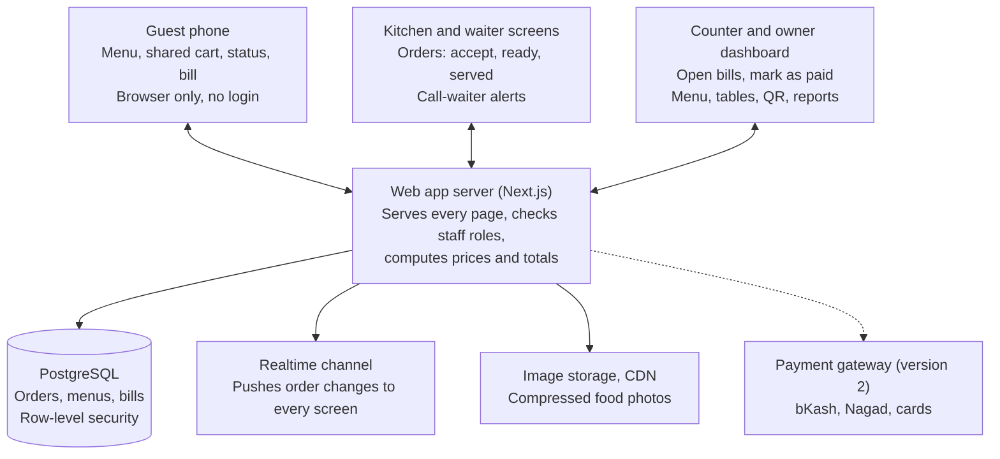
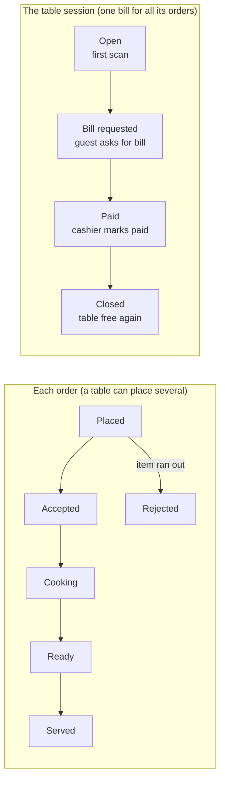

# QR Table Ordering for Restaurants in Bangladesh — Product Plan

As of 2026-11-10

## Summary

Build a web app, not a mobile app: a guest scans the QR on the table, the menu opens in the phone browser, and the whole meal runs from there. Nobody downloads anything and nobody needs to sign up to order.

The product has two sides. Guests get the menu, a cart shared by everyone at the table, a live order status with a ready-time estimate, the bill, and a review form. The restaurant gets a kitchen screen for incoming orders, a counter screen to mark bills paid, and an owner dashboard for menu, tables, QR codes and sales.

The recommended approach is to start small and sell hard:

- **Version 1 takes cash and a manual "mark as paid" only.** Online payment (bKash, Nagad, cards) comes in version 2, because gateway onboarding in Bangladesh needs a trade licence and takes weeks.
- **Keep the waiter.** The waiter still brings the food and helps guests who will not scan. The product removes the waiting, not the person.
- **Pilot with 3 to 5 restaurants for free** before charging anyone, then charge a flat monthly fee per restaurant.
- **One codebase serves every restaurant** (multi-tenant), so adding restaurant number 50 costs you almost nothing.

Sections 2 to 5 are the non-technical plan. Sections 6 to 8 are the technical plan. Sections 9 and 10 are the roadmap and the decisions still open.

## 2. Guest workflow (non-technical)

A guest goes from sitting down to leaving in ten steps, all inside the phone browser.

1. **Scan.** The guest points the phone camera at the QR on the table. The restaurant's menu opens, already knowing which table it is.
2. **Browse.** The menu shows categories, photos, prices in taka, and a Bangla/English switch. Sold-out items are greyed out.
3. **Build the order together.** Everyone at the table who scans joins the same table cart. Each person sees what the others add, with a name on each item ("Rafi added 2 naan").
4. **Place the order.** One person taps Place order. They can add notes such as "less spicy" or "no onion".
5. **Watch the status.** The screen shows Received, Cooking, Ready, Served, with an estimated time in minutes that counts down.
6. **Order more.** A second round (drinks, dessert) is added to the same bill.
7. **Call a waiter.** A button asks for a waiter, water or tissue without shouting across the room.
8. **Ask for the bill.** The guest sees the itemised bill with VAT and service charge.
9. **Pay.** In version 1 the guest pays cash or card to the waiter or at the counter. In version 2 they can pay by bKash, Nagad or card on the phone. Staff mark the bill paid and the guest's screen changes to Paid with a digital receipt.
10. **Review.** The guest rates the dishes and the service from 1 to 5 stars and can leave a comment. A tip option can sit here too.

A guest who does not want to scan still orders the old way. The waiter enters that order into the same system from a staff phone, so the kitchen sees one queue.

### Common situations at the table

Three everyday cases need a clear rule: ordering more, sharing a table with strangers, and fixing a mistake.

**You ordered biryani and now want a borhani.** Tap Add more items, pick the borhani and place it. It goes to the kitchen as a new round for the same table, marked as an add-on, and lands on the same bill. You can do this as many times as you like until you ask for the bill.

**Two strangers sit in the empty seats at your table.** The bill belongs to a group, not to the table. When someone scans a table that already has an open order, the app asks one question:

- **Join the existing order.** Someone already in that group gets a prompt, "Karim wants to join your order", and taps Allow. This is for a friend who arrives late.
- **Start a separate order.** The newcomers get their own cart, their own orders and their own bill.

The kitchen and waiter then see "Table 12, Group A" and "Table 12, Group B", each with the name of the first guest, so the food goes to the right people. The cashier sees two bills. Strangers can never add items to your bill, because joining needs your Allow tap.

**You ordered one plate of biryani too many.** What you can do depends on how far the order has gone:

| Order status | What the guest can do |
| --- | --- |
| Still in the cart | Change freely. A review screen shows every item and who added it before anyone taps Place order. |
| Placed, kitchen has not accepted yet | Change the quantity or cancel the item yourself. No staff needed. |
| Accepted or cooking | Tap Request change on the item. The kitchen or waiter sees the request and approves or declines it. Your screen shows the answer. |
| Served | Call the waiter. Only staff can remove it from the bill, and the app records who did it and why. |

The review screen prevents most of these mistakes. The app also warns when two people add the same dish: "Rafi already added 1 biryani. Add another?"

## 3. Restaurant workflow (non-technical)

The restaurant runs on four screens, and a small restaurant can run all four on one tablet.

| Role | Screen | What they do |
| --- | --- | --- |
| Owner or manager | Dashboard on laptop or phone | Adds menu items, photos and prices. Creates tables and prints their QR codes. Sees sales, best-selling dishes and reviews. |
| Kitchen | Kitchen screen on a tablet | Hears a sound when an order arrives. Accepts it, adjusts the ready time if busy, and marks it Ready. Marks items sold out. |
| Waiter | Staff view on a phone | Gets "Table 12 is ready" and "Table 7 is calling". Serves the food and marks it Served. Enters orders for guests who do not scan. |
| Cashier | Counter screen | Sees every open bill by table. Takes payment and marks the bill Paid, choosing cash, bKash, Nagad or card. Closes the table. |

A normal day looks like this:

1. Staff log in and open the restaurant for orders.
2. The kitchen marks anything unavailable today as sold out.
3. Orders arrive on the kitchen screen during service, each with table number and notes.
4. The cashier marks bills paid, which frees the table for the next guests.
5. At closing, the owner sees the day's total, split by payment method, to match against the cash drawer.

## 4. Features

Version 1 holds only what a restaurant needs to take a real order from scan to paid. Everything else waits until pilots ask for it.

| Feature | Why it matters | When |
| --- | --- | --- |
| QR per table, opens menu in browser | The core idea; no app install | Version 1 |
| Menu with photos, categories, sold-out switch | Photos raise the average bill | Version 1 |
| Shared table cart | Groups order together without passing one phone | Version 1 |
| Order notes and item options (size, spice level) | Cuts wrong orders | Version 1 |
| Live status and ready-time estimate | Replaces "bhai, how long?" | Version 1 |
| Kitchen screen with sound alert | The kitchen must never miss an order | Version 1 |
| Call waiter button | Keeps service human | Version 1 |
| Bill with VAT and service charge, manual mark-as-paid | Works with cash from day one | Version 1 |
| Star rating and comment after payment | Owners want feedback; guests like being asked | Version 1 |
| Waiter can enter orders for guests | Covers guests without smartphones or data | Version 1 |
| Bangla and English | Most guests prefer Bangla | Version 1 |
| Online payment: bKash, Nagad, cards | Faster checkout, less cash handling | Version 2 |
| Split bill between friends | Very common need for student and office groups | Version 2 |
| Sales reports and best-seller analysis | The reason owners keep paying | Version 2 |
| Tips for the waiter | Keeps waiters on your side | Version 2 |
| Kitchen ticket and receipt printing | Many kitchens still want paper | Version 2 |
| Offers, combos, "people also order" suggestions | Raises bill size | Later |
| Loyalty points and repeat-guest discounts | Brings guests back | Later |
| Multiple branches under one owner | Needed for chains | Later |
| Stock and inventory, takeaway and delivery | Different products; large scope | Later, if ever |

Three things to avoid early:

- **Forcing guests to sign up.** Every extra screen before the menu loses guests. Ask for a name only, and a phone number only when paying online.
- **A native mobile app.** Nobody installs an app for one dinner.
- **Building a full POS.** Restaurants that already have a POS will keep it. Sit beside it first; integrate later.

## 5. Business plan for Bangladesh (non-technical)

Sell to mid-range restaurants and cafes in Dhaka first, on a flat monthly fee, after proving the product in free pilots. The figures below are my starting suggestions, not researched market prices; test them in your first conversations with owners.

**Who to sell to first.** Cafes, burger and pizza places, and family restaurants in areas like Dhanmondi, Banani, Gulshan, Uttara and Bashundhara. Their guests are young, carry smartphones and already pay with bKash. Food courts are a strong second target because guests there already queue to order. Skip small rice hotels and very high-end dining for now.

**What the owner hears.** Owners do not buy technology; they buy results. Lead with these four:

- More tables served at peak hours, because nobody waits for a waiter to take the order or bring the bill.
- Fewer wrong orders, because the guest types the order themselves.
- Bigger bills, because photos and suggestions sell extra items.
- Honest numbers: every order is recorded, so the owner sees real sales and real reviews.

**How to charge.**

| Option | How it works | My view |
| --- | --- | --- |
| Flat monthly fee per outlet | For example 1,500 to 3,000 taka a month, with tiers by number of tables | Recommended. Simple to explain and predictable for the owner. |
| One-time setup fee | Covers menu entry, food photos and printed QR stands | Charge it after pilots; waive it for the first customers. |
| Percentage of each order | A small cut of every bill | Avoid at first. Owners dislike it and it needs online payment to enforce. |

**Pilot plan.**

1. Visit 20 to 30 restaurants in person with a working demo on your phone. Owners in Bangladesh buy from people they have met.
2. Sign 3 to 5 for a free two-month pilot. You enter their menu, take the photos and deliver the QR stands yourself.
3. Sit in the restaurant during the first busy evenings. Watch where guests and staff get stuck, and fix it that week.
4. Measure three numbers: share of tables that order by QR, average bill by QR versus by waiter, and minutes from sitting down to order placed.
5. Use those numbers and a short video testimonial from each owner as your sales material.

**The QR stand is part of the product.** Print it on an acrylic or wooden stand with the restaurant's logo, a short line such as "Scan to order" in Bangla and English, and the table number. A cheap paper sticker makes the whole service look cheap.

**Check the competition before you spend.** I have not looked up the current market for this document. View-only QR menus are already common in Dhaka, and some local POS companies may offer QR ordering. Your difference has to be the full loop: order, status, payment and review. Spend a day visiting restaurants and searching for local competitors before building.

## 6. Technical architecture

One web application serves the guest menu, the staff screens and the owner dashboard, backed by one database shared by all restaurants.

Every screen talks only to the web app server. The server owns the data and pushes each order change back to the screens that need it.

| Part | Recommendation | Why |
| --- | --- | --- |
| Front end and server | Next.js with TypeScript | One codebase for guest pages, staff screens and the API. Server-rendered menu pages load fast on slow mobile data. |
| Database | PostgreSQL | Orders and payments need transactions and strict relations. |
| Backend platform | Supabase (hosted Postgres, auth, realtime, file storage) | Gives a solo developer login, live updates and image storage without building them. Choose the Singapore region, the closest to Bangladesh. |
| Live updates | Supabase Realtime, or Socket.IO if you self-host | Pushes new orders to the kitchen and status changes to guests within a second. |
| Styling | Tailwind CSS, mobile first | Guests are on phones; staff are on tablets. |
| Images | Compressed WebP, served through a CDN | Food photos are the heaviest part of the page. |
| Hosting | Vercel to start; a VPS later if cost matters | No server management while you find customers. |
| Staff login | Phone number or email with password, with roles | Guests never log in. |
| Online payment (version 2) | A local aggregator such as SSLCommerz or aamarPay, which cover bKash, Nagad and cards in one integration | One contract instead of three. Check current fees and onboarding rules with them directly. |

Three design rules shape everything else:

- **Multi-tenant from day one.** Every row carries a `restaurant_id`, and database row-level security stops one restaurant from reading another's data.
- **Built for weak internet.** The menu page should be usable in under 3 seconds on a slow 4G connection. Cache the menu on the phone, and make the kitchen screen reconnect and reload missed orders by itself.
- **The server decides prices.** The phone sends item ids and quantities only. The server looks up prices and computes VAT, service charge and the total.

If you prefer another stack you already know well (Laravel, Django, or Node with Express), use it. Speed of delivery matters more than the framework. The architecture stays the same.

## 7. Data model

Fourteen tables cover version 1 and leave room for online payment.

| Table | Holds | Key fields |
| --- | --- | --- |
| `restaurants` | One row per restaurant | name, slug, logo, vat_percent, service_charge_percent, is_open |
| `staff_users` | People who log in | restaurant_id, name, phone, role (owner, kitchen, waiter, cashier) |
| `tables` | Physical tables | restaurant_id, label ("T12"), qr_token, is_active |
| `menu_categories` | Menu sections | restaurant_id, name_bn, name_en, sort_order |
| `menu_items` | Dishes | category_id, name_bn, name_en, price, photo_url, prep_minutes, is_available |
| `item_options` | Choices on a dish | menu_item_id, group ("Size"), name, extra_price |
| `table_sessions` | One visit by one group | table_id, group_label (A, B), status (open, bill_requested, paid, closed), opened_at, closed_at |
| `session_guests` | Phones that joined a visit | session_id, display_name, device_token |
| `cart_items` | The shared cart before ordering | session_id, guest_id, menu_item_id, quantity, options, note |
| `orders` | Each round sent to the kitchen | session_id, status, placed_at, estimated_ready_at, placed_by |
| `order_items` | Lines of an order | order_id, menu_item_id, name and price copied at order time, quantity, options, note, status (active, cancel_requested, cancelled), cancelled_by, cancel_reason |
| `payments` | Money received | session_id, amount, method (cash, bkash, nagad, card), status, gateway_ref, marked_by |
| `reviews` | Feedback after paying | session_id, menu_item_id (optional), rating, comment |
| `waiter_calls` | Call-waiter requests | session_id, reason, status, created_at |

Two modelling choices matter most:

- **The bill belongs to the table session, not to one order.** A visit can have several orders (starters, mains, dessert) and ends with one bill.
- **Order items copy the name and price.** If the owner changes a price next week, old bills must not change.

An order moves through these statuses, and the kitchen can reject it at the start if an item has run out.

The guest's review form unlocks when the session reaches Paid.

## 8. Key technical flows

Five flows carry most of the engineering risk; get these right and the rest is ordinary screens.

**QR code and table session.** Each table's QR holds a URL such as `yourapp.com/t/8fK2xQ`, where the last part is a random `qr_token`, not the table number. On scan, the server finds the table. If no session is open it starts one. If one is open, the guest chooses to join it, which needs approval from a guest already in it, or to start a separate session for a second group. A table can therefore hold several open sessions at once, labelled A, B and so on. The phone stores a `device_token` so a refresh returns the guest to the same session. When the cashier marks a group's bill paid, that session closes. The table is free once all its sessions are closed, and the next scan starts a fresh one.

**Stopping fake orders.** A printed QR never changes, so someone could photograph it and order from home. Use these defences together:

- The first order of every session waits for a staff tap on Accept before the kitchen cooks it.
- Sessions expire after a period with no activity.
- Rate-limit orders per device and per table.
- Optional for stricter restaurants: a short table PIN the waiter gives when seating guests.

**Shared cart.** The cart lives on the server in `cart_items`, not on each phone. Every phone in the session subscribes to a realtime channel named after the session. Adding an item writes a row, and all phones update. Place order runs one database transaction that turns cart rows into an order and empties the cart, so two people tapping at once cannot create a double order.

**Ready-time estimate.** Start simple: take the longest `prep_minutes` among the items, then add extra minutes for each order already in the kitchen queue. The kitchen can change the estimate with one tap when accepting. Store actual times from Placed to Ready; later you can replace the rule with real averages per dish and per hour. Show guests a range ("15 to 20 min"), because a missed exact time annoys more than a range.

**Payment.**

- Version 1: the guest taps Request bill, the session moves to `bill_requested`, the cashier collects money and taps Mark paid with the method. This writes a `payments` row and pushes Paid to the guest's phone.
- Version 2: the guest taps Pay online, your server creates a payment with the gateway and redirects the guest. Trust only the gateway's server-to-server confirmation, verified on your server, never the redirect back to the browser. Then mark the session paid the same way.

**Security checklist.**

- Row-level security on every table, keyed by `restaurant_id`.
- Staff actions (accept, mark paid, edit menu) check the staff role on the server.
- Guests can read and change only their own session.
- Record who marked each bill paid and when, so the owner can audit cash.
- Collect as little guest data as possible: a display name, and a phone number only for online payment.

## 9. Build roadmap

A single developer can reach a first paying restaurant in roughly four to five months. The durations are my estimates for one person working full time; adjust them to your pace.

1. **Validate (1 to 2 weeks).** Talk to at least 10 restaurant owners. Show a clickable design of the guest flow. Check competitors. Stop here if no owner wants a pilot.
2. **Build version 1 (5 to 7 weeks).** Menu and table setup with QR generation, then the guest menu and shared cart, then the kitchen screen with live updates, then bill, mark-as-paid and reviews. Build in that order so each step can be demonstrated.
3. **Pilot (8 weeks).** Run 3 to 5 restaurants for free. Be on site in the first week of each. Fix problems weekly and collect the three pilot numbers from section 5.
4. **Version 2 (4 to 6 weeks, overlapping the pilot).** Online payment, split bill, sales reports, tips and printing. Start the payment gateway application early, because approval takes time.
5. **Sell (ongoing).** Turn pilots into paying customers, set the price, and add restaurants area by area so one visit covers several customers.

Before you write code, also register the business and get a trade licence. Payment gateways and most restaurant owners will ask for it.

## 10. Risks and open decisions

The biggest risk is not the software; it is restaurants and guests not changing their habits.

| Risk | What to do about it |
| --- | --- |
| Guests ignore the QR and call the waiter anyway | Keep waiter ordering inside the same system. Train waiters to say "you can also scan here". Track the QR share per restaurant. |
| Waiters feel replaced and work against it | Present it as fewer trips and more tips. Add the tip feature. Let waiters use the staff view from day one. |
| Weak mobile data inside the restaurant | Keep pages light. Ask the restaurant to offer guest Wi-Fi and print the Wi-Fi name on the QR stand. |
| Kitchen misses an order | Loud repeating sound until accepted. Alert the manager if an order waits too long. |
| Owner hides sales to avoid a percentage fee | Charge a flat fee, so the owner has no reason to bypass the system. |
| Guests leave without paying | Unchanged from today: staff still see every open bill by table. |
| A competitor or POS vendor already offers this | Check before building. Compete on design, Bangla support, and personal service. |
| Payment gateway approval is slow | Launch on cash. Apply early. |

Decisions that are yours to make:

- [ ] Product name and domain
- [ ] Which city area to start in
- [ ] Tech stack: the recommended one, or one you already know
- [ ] Will you build alone or with a partner, and who does the selling
- [ ] Starting price and whether to charge a setup fee
- [ ] Whether the first order of a session needs staff acceptance by default
